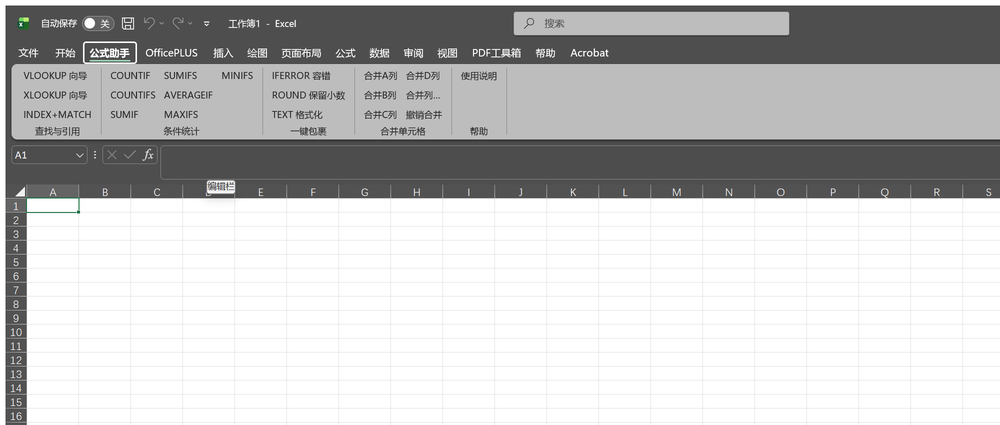
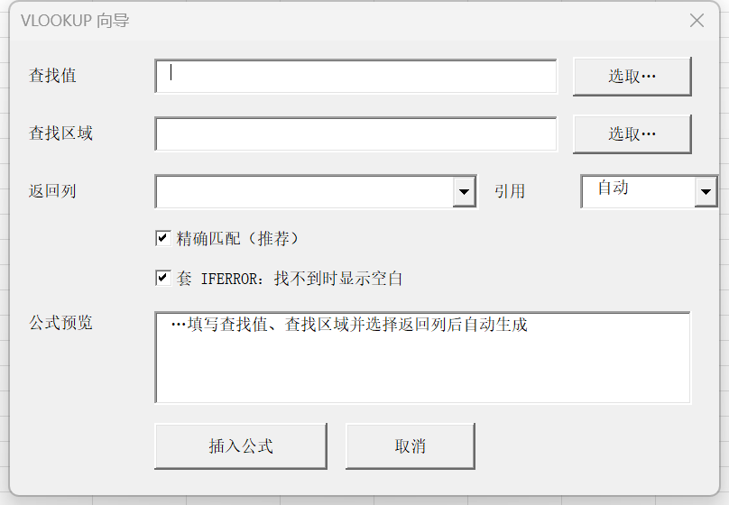
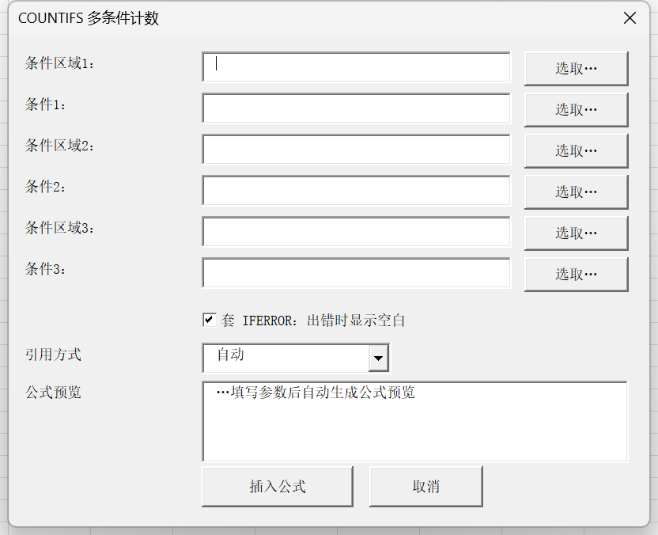

# 公式助手（Excel Formula Helper）

*One-click formula wizards, formula wrapping and same-value cell merging for Microsoft Excel — free and open source.*

一个轻量的 Excel 公式输入助手加载宏：用向导式界面快速生成 VLOOKUP、COUNTIF、SUMIFS 等常用函数公式，支持给已有公式一键套上 IFERROR / ROUND / TEXT，并把同列中连续相同的单元格批量合并。零依赖，下载即用。



## 功能

### 一、向导式公式生成

| 函数 | 说明 |
|---|---|
| VLOOKUP | 专用向导：分步选取查找值与查找区域，返回列下拉自动列出「列字母 + 表头」 |
| XLOOKUP | 通用向导（自动检测 Excel 版本，不支持时给出提示） |
| INDEX+MATCH | 组合公式，模板化生成 |
| COUNTIF / COUNTIFS | 条件计数 |
| SUMIF / SUMIFS | 条件求和 |
| AVERAGEIF / AVERAGEIFS | 条件求平均 |
| MAXIFS / MINIFS | 条件求最大/最小值 |



通用向导由配置表驱动，界面按参数个数自动伸缩：



### 二、一键包裹（针对已有公式）

先选中含公式的单元格，再点按钮：

| 按钮 | 效果 |
|---|---|
| IFERROR 容错 | `=SUM(A1:A9)` → `=IFERROR(SUM(A1:A9),"")` |
| ROUND 保留小数 | `=E2/E4` → `=ROUND(E2/E4,2)` |
| TEXT 格式化 | `=E2/E4` → `=TEXT(E2/E4,"0.00")` |

支持多选批量包裹、数组公式、跨工作表区域的自动表名限定。容错值可自定义（留空 = 显示空白，也可填 `0` 或单元格引用）。

### 三、合并单元格

把当前工作表指定列里**连续且值相同**的单元格合并成一格，常用于「部门 / 分类 / 项目」列的去重排版。

- **合并A/B/C/D列**：四个单列按钮，一键处理对应列
- **合并列…**：向导，支持任意列（`A`、`A,C`、`A:C`、`1,3` 混写），可框选
- **撤销合并**：合并前自动快照，可还原最近 3 次操作的值与合并状态

规则与边界：第 1 行默认视为表头不参与合并（向导里可取消）；合并后每组只保留左上角的值（Excel 固有行为）；错误值（#N/A 等）不参与合并；对已合并的列重复执行 = 0 处（幂等）；受保护工作表 / 共享工作簿 / 智能表格(ListObject) 会先预检查并提示。

### 四、参数输入的贴心处理

- **条件自动加引号**：输入 `>=60` 生成 `">=60"`，输入 `完成` 生成 `"完成"`，输入 `张*` 保留通配符，输入 `>B2` 生成 `">"&B2`
- **引用方式可强制指定**：向导里有「引用方式」下拉（`自动 / 相对 / 绝对 / 锁行 / 锁列`），对应 `B1`、`$B$1`、`B$1`、`$B1`；默认「自动」= 单格相对、区域绝对；只作用于区域类参数，选择会被记住（跨会话）
- **跨表自动限定**：区域在别的工作表时自动加 `'表名'!` 前缀，跨工作簿时自动加簿名
- **实时公式预览**：向导底部实时显示将要写入的公式，确认后再插入
- **就地框选**：每个参数都可用「选取…」按钮回到表格里用鼠标框选

## 安装

### 方式一：下载构建好的加载宏（推荐，无需 Python）

1. 到本仓库的 [Releases](../../releases) 页面下载 `公式助手.xlam`
2. 把它放到加载项目录：`%APPDATA%\Microsoft\AddIns\`（在文件管理器地址栏粘贴即可打开）
3. 打开 Excel →「文件」→「选项」→「加载项」→ 底部「管理」选「Excel 加载项」→「转到…」→「浏览」选中该文件并勾选启用
4. 若打开时提示宏安全警告，把该目录加入「信任中心 → 受信任位置」（下方的开关脚本会自动完成这一步）

### 方式二：脚本一键安装（需要 Python）

```bash
python build/install.py
```

环境要求：Windows + 已安装 Excel + Python 3.7+ 与 pywin32（`pip install pywin32`）。脚本会自动复制加载宏、把目录加入受信任位置、注册并启用；构建前请先关闭所有 Excel 窗口。也可以用等价的 PowerShell 版本：

```bash
powershell -ExecutionPolicy Bypass -File build\install.ps1
```

卸载：

```bash
python build/uninstall.py
```

### 启用/禁用一键开关

不想用插件的日子（或怀疑它与其他软件冲突时），一条命令临时停用，再跑一次恢复：

```bash
powershell -ExecutionPolicy Bypass -File build\toggle.ps1
```

- Excel 未运行时：切换注册表自启动槽位，下次启动 Excel 生效
- Excel 运行中：对本运行的实例立即加载/卸载（不关闭你正在用的表格，不碰其他加载项和文件）

安装后在功能区「开始」右侧出现 **公式助手** 选项卡。

## 使用注意

- 目标单元格已有内容时，向导会先询问是否覆盖
- 合并单元格后 Ctrl+Z 无法还原（Excel 对宏操作的固有限制），请使用插件自带的「撤销合并」；它只还原值与合并状态，不还原被合并吸收的单元格格式
- 一键包裹与合并都会实际修改表格，重要文件请先保存备份
- 所有公式以英文函数名 + 逗号分隔写入，与 Excel 界面语言和区域设置无关

## 兼容性

- Windows 版 Microsoft Excel 2007 及以上（在 Excel 365 / 16.0 上完整验证）
- XLOOKUP / MAXIFS / MINIFS 需要 Excel 2019+ 或 Microsoft 365，点击时会实测当前版本能力并给出提示
- 加载宏文件名为中文（`公式助手.xlam`）属正常，不影响任意语言版本的 Windows/Office
- WPS 表格未做验证；理论上支持 VBA 的 WPS 版本可运行，欢迎反馈

## 扩展接口

### 新增一个函数

只需在 `src/vba/modConfig.bas` 的 `GetAllFuncDefs` 里加一行，向导界面、参数输入、公式生成全部自动出现：

```
函数Key|界面显示名|公式模板|参数1|参数2|...
```

- **公式模板留空**：自动拼成 `FUNC(参数1,参数2,...)`，空参数自动跳过（中间跳空会提示）
- **公式模板含 `{n}`**：按模板替换，例如 `INDEX({1},MATCH({2},{3},0))`
- **参数格式**：`标签:类型:默认值:是否必填`，类型可选 `range`（区域，受引用方式影响）、`criteria`（条件，自动处理引号）、`value` / `text`、`number`、`any`

例如新增 RANK：

```vba
"RANK|RANK 排名||数值:value::1|引用区域:range::1|升序:number:0:0"
```

若新函数需要版本检测（如只在新版 Excel 可用），在 `modGenericWizard.bas` 的 `CapabilityOK` 中加一个分支即可。

### 新增/修改向导窗体

窗体不用手工画：`build/form_layouts.py` 用声明式描述每个窗体的控件（名称必须与 `src/vba/窗体名.code.vba` 事件代码一致），构建脚本在构建时动态创建窗体与控件，仓库中不保存二进制 `.frx`。改布局 = 改配置文件 + 重跑构建。

### 关键模块

| 模块 | 职责 |
|---|---|
| `modFormulaUtil.bas` | 公式构建与解析纯函数（引用生成、条件解析、包裹），与界面完全分离 |
| `modConfig.bas` | 函数定义表（扩展点）+ 用户偏好持久化 |
| `modGenericWizard.bas` | 通用向导引擎 + Excel 版本能力检测 |
| `modWrap.bas` | 一键包裹（核心函数无对话框，可自动化测试） |
| `modMerge.bas` | 合并单元格（含快照撤销） |

## 从源码构建与测试

环境要求：Windows + 已安装 Excel + Python 3.7+ 与 pywin32。

```bash
# 构建发布版 -> dist/公式助手.xlam
python build/build.py

# 构建含自测模块的测试版 -> dist/公式助手-test.xlam
python build/build.py --include-tests

# 安装 / 卸载 / 启用禁用开关
python build/install.py
python build/uninstall.py
powershell -ExecutionPolicy Bypass -File build\toggle.ps1
```

自动化测试：

```bash
# 纯函数 + 工作表集成 + 窗体级端到端（读 dist 产物，无需安装）
powershell -ExecutionPolicy Bypass -File build\test.ps1

# 合并 / 跨表回归（需先安装加载项）
python build/test_merge.py
python build/test_vlookup.py
```

测试覆盖：引用生成与条件解析、公式实算、包裹链路、合并与撤销（含错误值、幂等重跑）、跨表框选漂移回归等共 200+ 项断言。

## 项目结构

```
excel-formula-helper/
├── src/
│   ├── ribbon/customui.xml        # Ribbon 选项卡定义
│   ├── vba/                       # VBA 源码（纯文本，可 diff 可 review）
│   └── tests/                     # 窗体级自测模块（只进测试构建）
├── build/                         # 构建/安装/卸载/开关/测试脚本
├── dist/                          # 构建产物（不入库，走 Releases）
└── docs/                          # 截图与贡献者文档
```

## License

[MIT](LICENSE)
